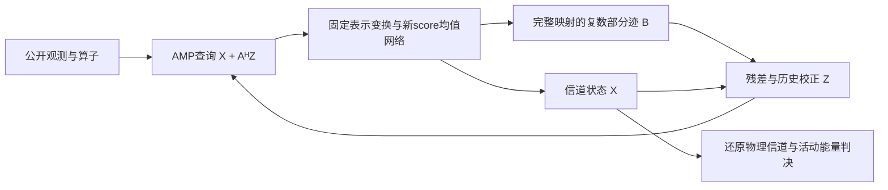

# 独立训练的 score 去噪器与矩阵 D-AMP

这是与原 Proposed 并行的第二套接收机，软件入口为 `diffusion_amp`。
原 Proposed 的三份权重、LMMSE/外信息更新、配置和已有结果均保留。
新网络从零训练；共用的是公开物理场景、固定尺度、可逆坐标变换和评分定义。
完整实验方案见 [PROTOCOL.md](history/experiments/diffusion_amp_20261015/PROTOCOL.md)，
论文全文和逐式审查见[文献目录](../references/score_amp_20261015/README.md)。

| 环节 | 原 Proposed | 本轮独立 score D-AMP |
|---|---|---|
| 线性更新 | LMMSE与Gaussian外信息 | 匹配滤波查询 X+AᴴZ |
| 学习模块 | 完整信道一阶score、二阶score、活动分类器 | 从零训练的一份连续噪声条件均值/score网络 |
| 先验与空间使用 | 完整用户信道及活动证据 | 逐波束活动混合边缘先验 |
| 反馈 | 外信息均值/方差 | 完整去噪导数的复矩阵Onsager校正 |
| 阻尼 | 保留原默认外信息阻尼设置 | 同步状态与历史校正，独立验证选择β |
| 活动输出 | 原分类器后验阈值 | 校准后的用户信道能量门限 |



## 1. 任务、已知信息与工作近似

当前接收模型为

\[
Y_{qmr}=\sum_{k=1}^{K}\sum_{n=1}^{N}P_{qkn}H_{kmrn}+W_{qmr},
\qquad W_{qmr}\sim\mathcal{CN}(0,\sigma_w^2).
\tag{1}
\]

这里 Q=16、K=40、N=16，阵列 M=16，输出索引 R=16。P 包含当前场景假定已知的
有效跨帧相位。公开输入仅为 Y、P、复噪声方差及活动先验；接收机不输入真实信道、
真实活动或真实方向。零用户内方向扩展、连续时延/Doppler 和非空活动场景与原比较保持一致。
未知相位需要额外估计，其旧实验不自动成为本轮新算法的验证。

取固定总体尺度 s=0.2647966452702405，沿已知 4×4 UPA 施加单位 DFT，记为 U。
该变换不需要真实或估计方向，并保持 Euclidean 范数及白噪声方差。
按行 i=(k,n)、列 a=(m,r) 排列信道，定义

\[
g^2=\frac{\sum_{qkn}|P_{qkn}|^2}{KN},\qquad
A_{q,(k,n)}=P_{qkn}/g,
\quad y=\operatorname{reshape}(UY)/(sg),
\quad X=\operatorname{reshape}(UH)/s.
\tag{2}
\]

于是 y=AX+w，A 的平均列范数平方为 1；输出还原为 sUᴴX。
此归一化是恒等变换，不会把结构化 AFDM 算子变成 iid Gaussian 矩阵。

逐波束的16×16查询还经固定单位变换 T：逆 DAFT 的两轴、循环 lag 重排、时间轴 DFT。
保留全部系数；没有取真实路径或截断 off-grid 泄漏。具体数值变换复用
`algorithm/ldamp/representation.py`，但不复用其学习参数。

## 2. 从任务先验到连续噪声 score

对活动物理信道投影得到 G，训练随机抽一个波束，构造

\[
C=aG,\quad a\sim\operatorname{Bernoulli}(\rho),\quad \rho=0.1,
\qquad R=C+\sqrt v E,\quad E\sim\mathcal{CN}(0,I).
\tag{3}
\]

单个共享网络不读取波束编号，学习的是波束边缘的汇总先验；它不显式利用一个用户
所有波束共享同一活动变量的联合约束。这是本方案的重要近似。
接收测试条件于至少一人活跃，公开边缘先验为 0.1/(1−0.9⁴⁰)≈0.1015，
与训练的 0.1 有小幅区别。当前权重只针对这个固定负载附近的任务，不宣称可直接用于任意活跃率。

令 c、r 为实虚双通道坐标，\(\tau=v/2\)。即便清洁先验包含零点质量，正方差
Gaussian 卷积后的密度仍可求导。直接微分积分得到

\[
\nabla_r\log p_\tau(r)
=\frac{\int (c-r)p(c)p(r\mid c)\,dc}{\tau p_\tau(r)}
=\frac{\mathbb E[c\mid r]-r}{\tau}.
\tag{4}
\]

因此以 \(D_\theta\) 参数化均值时，定义

\[
s_\theta(r,v)=\frac{D_\theta(r,v)-r}{v/2},\qquad
D_\theta=r+(v/2)s_\theta.
\tag{5}
\]

混合先验已经包含活动概率的后验收缩；再次乘旧活动网络输出会改变目标均值。
一次 AMP 迭代调用一次此均值，不需要完整反向扩散采样。
Gaussian 多噪声训练是 score-based diffusion 的先验学习方式；当前实现是其去噪应用，
不能等同于已复现 DMP-DUN 的端到端图像展开或 ICC 2024 的反向采样模块。

逐样本有加权 DSM 恒等式

\[
\lambda_D(v)\|D_\theta(r,v)-c\|^2
=\lambda_D(v)\tau^2
\left\|s_\theta(r,v)+\frac{r-c}{\tau}\right\|^2.
\tag{6}
\]

所以实际训练对应 \(\lambda_s(v)=\lambda_D(v)\tau^2\)，不是把各噪声等权的
均值损失与 score 损失混为一谈。无限容量的总体最优解为式(4)，有限网络仅是近似。

## 3. 从零训练的网络

采用 EDM §5/Table 1 的预条件形式，\(q=\sigma_{data}^2\) 为混合训练总体的每实坐标方差
（约0.05，由固定训练总体功率和ρ计算），

\[
D_\theta(r,v)=c_{skip}r+c_{out}F_\theta(c_{in}r,c_{noise}),
\tag{7}
\]
\[
c_{skip}=\frac q{q+\tau},\quad
c_{out}=\sqrt{\frac{q\tau}{q+\tau}},\quad
c_{in}=(q+\tau)^{-1/2},\quad
c_{noise}=\tfrac14\log\sqrt\tau,
\quad\lambda_D=1/\tau+1/q.
\tag{8}
\]

F 使用48通道、4个双卷积残差块、SiLU和连续 log-noise 的 Fourier 特征/MLP条件编码。
噪声条件控制通道尺度与平移。没有 batch 统计或跨样本操作，保证用户/波束之间的网络导数为零。
总参数198,322。输出卷积初值为零，所以初始均值是 Gaussian 线性收缩；其余权重随机初始化。
这些宽度和骨干选择为项目实现，不是原文指定的 AFDM 网络。

训练使用50,000个完整物理信道样本、12,500个场景；5,000验证样本来自另1,250个场景。
模型和场景身份均核验哈希。每批64块，log-uniform复方差 v∈[0.001,100]，
一半活跃、一半为零，按0.2和1.8作重要性加权，维持0.1/0.9目标先验。
还使用物理先验允许的公共相位增广。网络从零训练15,000步后保留完整状态续训至30,000步；
固定AWGN验证目标选中27,000步。达到预设上限时没有满足8次验证plateau，故不声称训练全局收敛。
训练记录、全/活跃/非活跃误差以及零估计和线性收缩对照见
[训练报告](../docs/history/runs/diffusion_amp_20261015/continuation_v1/REPORT.md)。

## 4. 复数矩阵 D-AMP 与 Onsager 系数

初始化 \(X^0=0,Z^0=y\)，无阻尼时为

\[
R^t=X^t+A^HZ^t,
\quad\Sigma^t_{ab}=Q^{-1}\sum_qZ^t_{qa}\overline{Z^t_{qb}},
\quad v_m^t=R^{-1}\sum_r\Sigma^t_{(m,r),(m,r)}.
\tag{9}
\]

记 \(\mathcal D_t\) 为包含 T、实虚打包、网络和 T⁻¹ 的完整复映射，使用每束固定标签
\(v_m^t\)。当前去噪近似只利用块内平均方差，不等同于对任意 \(\Sigma^t\) 的精确协方差条件去噪。
矩阵递推为

\[
\widetilde X^{t+1}=\mathcal D_t(R^t),\qquad
B^t_{ab}=\frac1Q\sum_{i=1}^{KN}
\frac{\partial[\mathcal D_t(R^t)]_{ib}}{\partial R^t_{ia}},
\tag{10}
\]
\[
X^{t+1}=\widetilde X^{t+1},\qquad
Z^{t+1}=y-AX^{t+1}+Z^tB^t.
\tag{11}
\]

分母是观测数Q，不能误用KN或双实坐标数。导数为Wirtinger导数，
取输入列a到输出列b的部分迹，所以校正在右侧写ZB。逐波束结构使B的跨波束块严格为零，
每个16×16块仍保留；T会混合原来的行/输出索引，不能只取网络像素散度来替代。

用自动微分计算实际去噪映射的实方向导数 \(J_{\mathbb R}[u]\)，配对消除共轭部分：

\[
J_z[u]=\tfrac12\{J_{\mathbb R}[u]-iJ_{\mathbb R}[iu]\}.
\tag{12}
\]

使用随机相位和随机行置换的DFT正交列作为每束探针，平均8份

\[
\widehat B^t_{ab}=\frac1{8Q}\sum_{\ell=1}^{8}\sum_i
\overline{u^{\ell}_{ia}}[J_z[u^\ell]]_{ib}
\tag{13}
\]

并将跨束块置为结构规定的零。该估计针对随机探针在期望上给出部分迹；有限探针仍有误差。
实际记录校正作用ZB的 Monte Carlo 标准误差诊断。
求偏导时冻结噪声标签；这遵循去噪器偏导接口，并不证明标签自适应满足有限AFDM状态演化假设。

## 5. 一致的状态阻尼

为对比β=1与β=0.5，令 \(C^0=0\)，保留历史校正：

\[
X^{t+1}=(1-\beta)X^t+\beta\widetilde X^{t+1},
\quad C^{t+1}=(1-\beta)C^t+\beta Z^tB^t,
\quad Z^{t+1}=y-AX^{t+1}+C^{t+1}.
\tag{14}
\]

这是同时松弛X、Z的递推；展开C得
\(C^{t+1}=\sum_{s=0}^t\beta(1-\beta)^{t-s}Z^sB^s\)。
B只对原始 \(\mathcal D_t\) 求导，不再重复乘β。方差由实际混合后的Z计算，
天然含跨轮交叉项。不能只对X做阻尼、只留当前βZB，或把各轮方差直接加权平均。
不裁剪Jacobian到[0,1]：真实MMSE均值的Jacobian也不保证逐点非扩张。

## 6. 活动读出、失败与比较

每个用户以最终物理信道 Frobenius 能量判活动，在独立校准场景拟合单一跨SNR门限。
没有再据判决把信道硬置零，信道NMSE覆盖所有候选用户。门限绑定权重、源码、尺度和求解器哈希。
输入方差超出训练支持时返回FAILED和最后有效状态，而不将其标作完成估计；
不通过方差裁剪隐去失配。12轮是预定迭代预算，不代表收敛声明。

原Proposed使用完整信道一、二阶score及活动分类器，经LMMSE/外信息迭代；
新方案只使用一份逐波束score均值网络、真实导数和AMP残差，活动在末端校准。
两者既不同于简单替换网络，也不构成可由学习先验单独保证的收敛定理。

小型测试已核验复部分迹/共轭导数抵消、1/Q与块位置、β=1和已有矩阵迭代一致、
历史阻尼、方差失败状态、score恒等式和完整表示方向导数。实际完整接收机比较和
保护文件核验统一见 结果报告（历史文件已清理，原路径：`results/diffusion_amp_20261015/REPORT.md`）。

## 7. 使用

```sh
.venv/bin/python scripts/run_diffusion_amp.py --input NEW_CASE/input.npz --output NEW_SCORE_AMP.npz --device mps
.venv/bin/python run.py run --method proposed --input NEW_CASE/input.npz --output NEW_PROPOSED.npz --device mps
.venv/bin/python run.py evaluate --estimate NEW_SCORE_AMP.npz --truth NEW_CASE/truth.npz
.venv/bin/python -m pytest -q tests/test_diffusion_amp.py
```

新算法使用 `configs/diffusion_amp.json`、`models/diffusion_amp/score.pt` 和独立活动门限。
原有六算法主入口和冻结资产清单保留原定义。重训入口及精确续训命令见训练报告；
配对实验可通过 `experiments/diffusion_amp_20261015/run_comparison.py` 分阶段复查，
已完成输出仅在哈希一致时复用，不能覆盖旧结果。

## 理论与结论范围

L-DAMP 的状态演化依赖测量矩阵和去噪器等条件；当前有限、结构化AFDM没有据此建立证明。
逐束标量噪声模型仍可能遭遇束内相关和非Gaussian误差。
这轮工作的完成标准是可复现的独立实现、已训练模型、正确导数与真实闭环比较，
不是宣称Onsager必然白化、优于Proposed，或给出新的AMP理论。
文献术语和原文定位统一列于 [TERMINOLOGY.md](TERMINOLOGY.md)。
