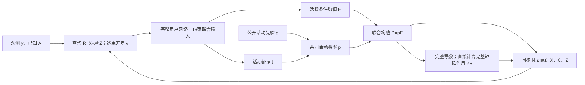

# 完整用户联合去噪的矩阵 D-AMP

日期：2026-10-15。软件入口 `joint_amp`。原 Proposed 和逐波束 `diffusion_amp`
保留为独立算法。本文定义新增方法的模型、训练目标、导数、循环及适用范围；
实测结论以 [实验方案](../docs/history/experiments/joint_amp_20261015/PROTOCOL.md) 和对应结果为准。

## 1. 本次“完整性”的范围

原 Proposed 同时使用完整用户信道、用户共同活动变量、学习均值/二阶风险和
Gaussian 消息近似。此前 `diffusion_amp` 学习逐波束混合先验，活动识别另取最终
能量门限。新增版本补齐完整用户条件均值、共同活动概率和相应的完整输入导数。

| 内容 | 原 Proposed | 本版本 |
|---|---|---|
| 未知量 | 完整用户信道及共同活动变量 | 相同 |
| 学习信息 | 完整用户均值、二阶风险、活动分类器 | 完整用户活跃条件均值及活动密度比 |
| 线性观测反馈 | LMMSE 与 Gaussian 外信息 | 残差矩阵 AMP 与 Onsager 校正 |
| 不确定性接口 | 当前配置采用各向同性 Gaussian 近似 | 每波束一个复方差；完整矩阵导数反馈 |
| 最终活动输出 | 学习的活动概率 | 最后接受查询的共同活动概率 |
| 当前理论边界 | 有限网络及近似消息，非精确联合后验 | 有限网络及近似查询，AFDM 状态演化未获证明 |

矩阵 AMP 需要的是实际去噪映射的导数，不需要另外复制 Proposed 的二阶网络和
外信息除法。两种方法在建模对象上可以对齐，消息近似和数值递推仍然不同。
“完整用户”指信号先验输入范围；不表示传递 4096×4096 的完整噪声协方差。

## 2. 观测重排与尺度

沿用当前物理系统和公开接收机输入。设候选用户 K=40、帧数 Q=16、每用户
输入维 N=16、输出维 R=16、天线/波束数 M=16。物理模型为

\[
Y_{qmr}=\sum_{k=1}^K\sum_{n=1}^N P_{qkn}H_{kmrn}+W_{qmr}. \tag{1}
\]

先对 Y 的天线轴作固定 4×4 UPA 单位 DFT，H 作同一变换。以训练总体固定
复 RMS s=0.2647966452702405 归一化，定义 L=KN=640、C=MR=256，

\[
g^2=\|P\|_F^2/L,\quad
A_{q,(k,n)}=P_{qkn}/g,\quad
X_{(k,n),(m,r)}=H_{kmrn}/s,\quad y=Y/(sg).
\tag{2}
\]

于是 y=AX+w，且 ||A||²_F=L。g 只依赖已知算子，s 只依赖训练先验定义；
两者不读取测试真值。输出经过逆波束 DFT 并乘 s 还原。

去噪器内部还使用既有固定可逆时间/时延 DFT 表示 T_rep。它在每用户内混合
n、r 轴，因此严格置于 D=T_rep⁻¹ Dθ T_rep 及其导数链内，不能直接移到
观测算子外部。16 个方差标签在同一束内恒定，故该束内部单位变换保持噪声模型。

## 3. 完整用户先验与共同活动

每个用户用一个活动变量 a_k，所有波束共享它：

\[
a_k\sim\operatorname{Bernoulli}(\rho),\quad h_k\sim p_H,\quad x_k=a_kh_k.
\tag{3}
\]

h_k 是归一化并变换后的完整 4096 维复信道，其物理训练分布包含跨束相关性。
学习模块的工作模型是

\[
r=x+e,\qquad e\mid V\sim\mathcal{CN}(0,V),\qquad
V=\operatorname{diag}(v_m I_{RN})_{m=1}^M.
\tag{4}
\]

此处条件独立 Gaussian 噪声是假设，不是 AFDM 实际查询已经满足的事实。
定义活跃和非活跃的查询密度

\[
q_1(r\mid V)=\int\phi_V(r-h)p_H(dh),\quad q_0(r\mid V)=\phi_V(r),
\quad \ell_* =\log(q_1/q_0).
\tag{5}
\]

Bayes 公式及条件期望直接给出

\[
p_*=\Pr(a=1\mid r,V)=\operatorname{sigmoid}(\operatorname{logit}\rho+\ell_*),
\quad F_*=\mathbb E[h\mid r,a=1,V],\quad D_*=p_*F_*=\mathbb E[x\mid r,V].
\tag{6}
\]

训练 Fθ 和 ℓθ 后使用 Dθ=pθFθ。pθ 是一个用户一个数，不是 16 个独立
波束概率的乘积。接收机每个输入读取公开 ρ；当前非空活动场景的边缘值为
0.1/(1−0.9⁴⁰)。这一边缘修正没有建模用户之间“至少一个活跃”的完整联合约束。

## 4. 两个训练目标及 score 含义

将复向量展开为实、虚两通道，实噪声协方差 T 的对应元素为 τ_m=v_m/2。
令 γ=σ_data² 为**活跃条件**归一化实功率（训练总体约 0.50022），采用

\[
c_{\mathrm{skip},m}=\frac\gamma{\gamma+\tau_m},\quad
c_{\mathrm{in},m}=(\gamma+\tau_m)^{-1/2},\quad
c_{\mathrm{out},m}=\sqrt{\frac{\gamma\tau_m}{\gamma+\tau_m}},
\]
\[
F_{\theta,m}=c_{\mathrm{skip},m}r_m+
c_{\mathrm{out},m} f_{\theta,m}(c_{\mathrm{in}}\odot r,\boldsymbol v).
\tag{7}
\]

这是 EDM 预条件公式的逐束应用；γ 不再乘活动率。以活跃样本训练

\[
\mathcal L_F=\mathbb E\big[\|F_\theta(r,V)-h\|^2_{W(V)}\mid a=1\big],
\quad W_m=c_{\mathrm{out},m}^{-2}=2/v_m+1/\gamma.
\tag{8}
\]

对固定 (r,V)，风险分解为条件方差加 ||Fθ−F*||²_W，故无限制函数的最优
解为 F*。权重依赖 V，不改变这一逐条件最优值；有限网络仍有容量和优化误差。

活动证据头使用等量正负样本、相同 V 采样分布，不加部署活动率类别权重：

\[
\mathcal L_\ell=\tfrac12\mathbb E_{q_1}\log(1+e^{-\ell_\theta})+
\tfrac12\mathbb E_{q_0}\log(1+e^{\ell_\theta}). \tag{9}
\]

逐条件微分得到最优 ℓθ=log(q₁/q₀)，部署时再加 logitρ。训练若采用不同
类别先验或两类不同 V 分布，则必须扣除它们造成的 log-odds 偏置。本实现
通过平衡批次和两类完全相同的一组 V 标签避免该偏置。

实坐标下

\[
s_{1,\theta}=T^{-1}(F_\theta-r),\qquad
s_{\mathrm{mix},\theta}=T^{-1}(p_\theta F_\theta-r). \tag{10}
\]

式(8)等价于活跃条件 denoising score matching 的加权形式：第 j 个坐标的
score 权重为 W_j τ_j²。实际总损失 L_F+L_ℓ **不是**直接对混合均值 pF
做 DSM/MSE 的恒等变换。两个目标在总体最优下相容，但有限双头未必对应同一
精确密度，也未必满足

\[
\nabla_r\ell_*=T^{-1}F_* . \tag{11}
\]

训练报告描述 ||Fθ−T∇ℓθ||/||Fθ||，不据其事后选择有利检查点或改门限。
本版本用连续噪声条件的去噪/score 参数化，不运行反向扩散采样过程。

网络共用完整用户主干：32 个实输入通道、96 个隐藏通道、4 个残差块、
16 标签的 Fourier 条件嵌入。条件均值头还原 32 通道；活动头读取共享特征、
二阶特征和逐束能量。没有跨用户运算或 BatchNorm，单用户输出不依赖批次组成。
具体训练预算、固定噪声分层和检查点规则见
[训练方法](../experiments/joint_amp_20261015/training/METHOD.md)。

## 5. 完整 Onsager 导数

固定本轮 V、ρ 和参数，对实际 D=pF 求输入导数。在实坐标的“输出行、输入列”
约定下

\[
J_D=pJ_F+p(1-p)F(\nabla\ell)^\top. \tag{12}
\]

所以活动概率不能 detach，跨束块不能删除。即使 F 逐束独立，共同 p 的梯度
通常仍使跨束导数非零。对理想条件均值，有

\[
J_{D_*}=\operatorname{Cov}(x\mid r,V)\,T^{-1}. \tag{13}
\]

异方差下 J_D 一般不是普通对称矩阵；不能将导数强制对称、取实或截到 [0,1]。
不假设实际神经网络满足式(13)，Onsager 中直接使用其真实导数。

矩阵形状采用输入特征 a 在前、输出特征 b 在后：

\[
(B_t)_{ab}=\frac1Q\sum_{i=1}^L
\frac{\partial D_{ib}(R_t;\boldsymbol v_t,\rho)}{\partial R_{ia}},
\qquad B_t\in\mathbb C^{256\times256}. \tag{14}
\]

该 ∂/∂R 为 Wirtinger 偏导。设 L_D(U) 为完整实映射的方向导数，则

\[
J_z[U]=\tfrac12\{L_D(U)-iL_D(iU)\},\qquad
\widehat B_t=\frac1{PQ}\sum_{p=1}^P U_p^H J_z[U_p]. \tag{15}
\]

若 E[conj(U_ia)U_jc]=δ_ijδ_ac，式(15)条件期望为式(14)。本实现采用带独立
随机行/列相位的正交 DFT 列，L≥C；每元素模为 1，且 UᴴU=LI。对已知映射
D(R)=RW，单探针即准确得到 (L/Q)W。非线性/跨行映射仍有 Monte Carlo 误差。
早期开发实现每轮使用 16 组矩阵探针、每组两个自动微分 JVP，固定种子且逐轮更新。
此选项仍保留在 `correction_estimator=matrix`；正式比较改用下文直接计算 ZB 的实现。

实际估计还将直接跳连的已知导数精确扣加。固定查询后设
S₀,ia=p_k(i)c_skip,m(a)，L₀(U)=S₀⊙U，B₀=diag(Σ_i S₀,ia/Q)，则使用

\[
\widehat B_t=B_0+\frac1{PQ}\sum_pU_p^H\{J_z[U_p]-S_0\odot U_p\}.\tag{15b}
\]

两处使用完全相同的 S₀ 数组，故期望仍为式(14)。p 和 c_skip 在每个用户/波束
的时间表示块内恒定，直接项可与 T_rep 往返交换。这里只扣除 p c_skip I，
完整 JVP 中的 F dp、CNN 导数及跨束项全部保留，未重复乘 β。常量 B₀ 加回
每个探针样本后计算标准误差和校正范数。此分解可能减少随机非对角误差，但
若剩余导数与直接项强负相关，也可能增大方差；开发检查与未采用分解的早期
闭环均保留，不将单查询的改善称为普适结论。

实际使用完整 T_rep⁻¹ Dθ T_rep 的导数；p、F、归一化预条件和固定表示都
在计算图/链式变换内。每轮记录 ||ZB||/||Z|| 及探针均值的标准误差。
配对公式分离 J_z 与 J_bar，不证明 proper-complex 随机测量条件在 AFDM 中成立。

### 直接计算完整校正 ZB

当前网络在用户之间独立；冻结本轮 V 和 ρ 后，J_{kn,b;k'n',a}=0（k≠k'）。
取每用户 N×N 的随机相位正交基 η_k，使 η_kᴴη_k=NI。条件于这些完整基，
再作一次独立、共用的均匀列置换，前 P 列构成无放回样本。对每个样本 p 和观测行 q，构造

\[
U^{p,q}_{kn,a}=\eta_{kn,p}Z_{qa},\qquad
T_{p,qb}=\frac1Q\sum_{k,n}\overline{\eta_{kn,p}}J_z[U^{p,q}]_{kn,b}.
\tag{15c}
\]

展开 J_z 并使用行方向正交性，得到

\[
\frac1N\sum_{p=1}^N T_p=ZB,\qquad
\widehat{ZB}=\frac1P\sum_{p\in S}T_p,\qquad
\mathbb E[\widehat{ZB}\mid\text{完整基}]=ZB.
\tag{15d}
\]

跨波束、跨特征及用户内跨行导数都保留。Z 在本次 JVP 中是固定方向系数；
不能再对其历史求导，也不能把返回的校正再乘一次 Z。因为 |η|=1，直接跳连的
贡献在每个 T_p 中已经精确，无需额外扣加；完整 JVP 仍包含活动概率导数。
采用此选项时不构造 B，各项 B 范数和 trace(B) 日志记为未计算，不用 ZB 的量替代。

P>1 时，探针样本给出的 Frobenius 标准误差估计为

\[
\widehat{\mathrm{SE}}^2=
\frac{1-P/N}{P(P-1)}\sum_{p\in S}\|T_p-\widehat{ZB}\|_F^2.
\tag{15e}
\]

该平方量估计固定完整基下的抽样均方误差；平方根不声称无偏，亦不是置信区间。
P=1 的单样本标准误差不可用；P=N 的抽样误差为零，但仍有数值 JVP 误差。
此精确性依赖用户独立性，未来若加入跨用户注意力或批次统计，必须重新推导。

正式配置固定 `correction_estimator=user_row`、P=2：每轮 QP=32 个复方向，
由 64 个实 JVP 实现，是早期 16 矩阵探针的两倍方向预算。选择两个行方向兼顾
计算误差与可估计的样本标准误差，不宣称它是最优探针数量。完整 N=16 仅作数值参考。
固定 30000 步开发查询的数值依据见
[直接校正审计](../docs/history/results/joint_amp_20261015/projected_development_v1/REVIEW.md)：
相同 16 个复方向时，校正误差/‖Z‖ 从 0.514 降到 0.172；两个行方向时为 0.120。
这一结果没有读取信道真值，也不能直接证明闭环性能改善。正式验证前的修订记录
和早期源码保存在 `docs/history/experiments/joint_amp_20261015/archive_matrix_v1/`。

## 6. 循环、方差和同步阻尼

初始化 X₀=0、C₀=0、Z₀=y。第 t 轮依次计算

\[
R_t=X_t+A^H Z_t,\qquad
\Sigma_{t,ab}=Q^{-1}\sum_q Z_{t,qa}\overline{Z_{t,qb}},\qquad
v_{t,m}=R^{-1}\sum_{r=1}^R\Sigma_{t,(m,r),(m,r)}.
\tag{16}
\]

Σ 是残差二阶矩；网络只使用其按束平均的对角，未使用完整有色协方差。
这里没有把 Σ 自动等同真实查询误差协方差。公开热噪声方差是输入信息，但
此残差 AMP 的方差估计使用 Z 的能量，而非 Proposed 的显式 LMMSE 方差递推。

在 (R_t,v_t,ρ) 得到 D_t、p_t，并按式(15c)–(15d)估计 Z_tB_t。
以下写出其目标递推；实现中用上述估计替换 Z_tB_t。固定 β∈(0,1]，执行

\[
X_{t+1}=(1-\beta)X_t+\beta D_t,
\quad C_{t+1}=(1-\beta)C_t+\beta Z_tB_t,
\quad Z_{t+1}=y-AX_{t+1}+C_{t+1}. \tag{17}
\]

展开得 C_{t+1}=Σ_{s=0}^t β(1−β)^{t−s} Z_sB_s，与同步阻尼状态的历史反馈
一致。B 对原始 D 求导，不能先对 βD 求导后又在式(17)乘 β。β=1 恢复
无阻尼递推。实际混合 Z 的能量包含历史交叉项，不能把各轮方差按同一线性
权重混合来替代式(16)。

协议固定 12 轮、两个行方向、候选 β∈{0.5,1}；只在开发场景选择阻尼。所有方差必须在
训练支持 [0.001,100] 内。越界/非有限导数/非有限新状态记为 FAILED，保留
上轮完整有效状态和失败原因；不截方差、不把失败当作完成。

最终信道为最后接受轮的阻尼 X，经尺度和单位变换还原。活动输出为该轮
**原始查询**的 p，记录 probability_query_iteration，并固定 p≥0.5 判活跃。
不再乘一次 p，也不根据活动硬判决截断信道；p 不被解释成历史阻尼 X 的精确
对应后验。所有 NMSE 仅在推断结束后用隔离真值评价。

## 7. 理论边界和核查证据

式(5)–(13)在所列 Gaussian 查询工作模型与理想函数下成立；式(15)、(15d)和(17)
分别有明确探针期望及代数历史解释。有限网络误差、有限探针误差、残差方差
估计误差、有限 AFDM 的统计失配属于不同问题，应分别报告。

D-AMP/复矩阵 AMP 的随机矩阵、正则性及大系统条件不能由实验稳定或迭代少
反推成立。联合网络扩大信号建模范围，也增加训练、JVP 和矩阵反馈成本；
12 轮不能直接等同于比 Proposed 更快。当前实验比较完整接收机，不能将性能
差异单独归因为 Onsager、网络规模或共同活动中的某一个因素。

独立核查见 [MATH_AUDIT.md](../docs/history/experiments/joint_amp_20261015/MATH_AUDIT.md)。
针对实现的恒等式检查见 test_joint_amp.py（历史文件已清理，原路径：`tests/test_joint_amp.py`），覆盖跨束
部分迹及共轭项、同步阻尼、失败提交、先验 odds、完整 pF 导数、表示变换、
用户独立性及异方差 Gaussian 混合。

术语与原文定位统一见 [TERMINOLOGY.md](TERMINOLOGY.md)：EDM Table 1/§5，
分类器密度比 §2.2/§3，Kunde §III-C 式(18)–(21)/Remark 14，Fan §5 的历史偏导。
本文的物理重排、逐束噪声适配、网络及组合循环为项目明确给出的实现，
不包装成所引论文已经证明的 AFDM 算法。

## 8. 训练验证与接收机验证的区别

首次完整训练完成 63,342 次更新，以固定 AWGN 验证风险选择第 63,000 步。
随后在四个开发物理场景、三个 SNR 上检验最终权重：β=0.5 完成 5/12，
β=1 完成 3/12，其余均按原规则记录失败。两种配置均不满足零失败的选入条件，
因此本轮没有生成或读取独立测试。原始记录见
[首次验证](../docs/history/results/joint_amp_20261015/comparison_v1/solver_validation/SELECTION.json)。

对同一首轮开发查询的只读核查排除了权重、归一化、表示和 CPU/MPS 导数差异。
30,000→63,000 步的活动概率之和从 15.07 上升至 37.19（共40个候选用户）。
完整反馈分解为 p·dF 和 F·dp 后，前者的范数/‖Z‖ 从 0.902 增至 5.663，
后者从 0.169 降至 0.090。大反馈主要来自被高概率放行的条件均值导数，
不能简单归因为 sigmoid 导数、有限探针或设备误差。首轮完整校正还部分抵消了
过大的原始信道更新，因此不能只因校正大就将其裁掉。

这些现象与训练负类只含独立 Gaussian 噪声、实际查询含结构化干扰的失配相符；
目前并未证明它是全部失败的唯一原因。首轮的固定查询代数支持检验更强阻尼，
但不构成后续稳定性保证。中期权重与更强阻尼须在单独登记的开发验证中选择，
不得删除最终权重的失败或根据独立测试调参。

[LDAMP 原文](https://papers.neurips.cc/paper/6774-learned-d-amp-principled-neural-network-based-compressive-image-recovery.pdf)
§3（p.5）区分逐层与逐去噪器训练；§4.1 Finding 1、§4.2 Lemma 1（p.7）
给出其状态演化与训练最优性分析的条件。由纯 AWGN 风险改善推断这里的有限
AFDM 闭环一定改善，超出了这些条件。完整模型的实现、训练目标的一致性、
实际查询统计和闭环表现必须分别检验。

### 8.1 第 63000 步、β=0.2 的直接验证

在上述完全相同的 12 个开发输入上，固定最终权重与其余参数，仅将同步阻尼
设为 β=0.2（20% 新更新、80% 旧状态），结果为 6 个完成、6 个失败。
失败查询发生于第 6—12 轮，逐束复方差最大值为 117.75—157.86，超出训练支持域
上限 100。完整集合的正式 NMSE、AER 不可用，失败前的最后有效状态不替代完成输出。

6 个完成输入的合并 NMSE 为 +4.645866 dB，AER 为 15.833333%。其中场景
scene03、6 dB 的运行完成了 12 轮，但 NMSE 为 +12.904385 dB，40 个用户全部判为
活跃，产生 38 次虚警、0 次漏检。因此完成轮数本身并不能表明稳定或收敛。

原 Proposed 使用原配置、原权重运行相同的全部 12 个输入，12 个均完成并满足其
既定停止准则，合并 NMSE 为 −13.490396 dB，AER 为 0/480。在两者均完成的相同
6 个输入上，原 Proposed 为 −12.558090 dB、AER 为 0/240；该子集比较以完成为条件，
不能当作完整集合的无条件比较。NMSE 先累加平方误差和真值能量再转 dB。

此次检查没有生成独立测试，也没有改变原 Proposed。β=0.2 未使最终权重通过原定
零失败验证条件。逐例成绩、保留失败的轨迹与来源哈希见
[直接验证报告](../docs/history/results/joint_amp_checkpoint_20261015/step63000_beta0.2_review/REPORT.md)。

### 8.2 本次结果对设计判断的约束

当前实现补齐了完整用户输入、共同活动变量和实际映射导数，但这些实现层面的完整性
不构成实际查询服从所假设 Gaussian 信道的证据。首轮无 Onsager 历史时，对于非活跃
用户 k，查询精确写为 R_k=Σ_{j≠k}A_kᴴA_jX_j+A_kᴴw。训练负类却只含给定逐束
方差的独立 Gaussian 噪声；结构化其他用户干扰是否能由该模型充分近似必须另行检验。
同一个 scene00、−4 dB 输入实际有 3 个活跃用户，63k 网络首轮活动概率之和约 37.19。
这个观测支持优先检查训练与实际查询的分布匹配，但尚未隔离全部失败的唯一原因。

方差接口只传递残差二阶矩按束平均的对角；完整 Jacobian 校正并不等于完整误差
协方差描述。实际 R−X 的协方差与当前方差标签之间的校准、相关性和 Gaussian 近似
均不能由 JVP 数值核验替代。双头也未强制满足式(11)，三个固定 AWGN 输入上
‖F−T∇ell‖/‖F‖ 为 1.268、1.307、0.990；这是有限模型的概率解释缺口，不能单独
据此判定一般 D-AMP 递推非法，或断言强制该恒等式就能消除失稳。

随后按上述顺序执行了解析先验、随机 Gaussian/AFDM 算子与查询模型控制，结果见
§8.3。基础代数通过，但统计适配尚未解决；尚未重新接入学习网络或启动新训练。

### 8.3 解析先验下的基础递推与查询模型控制

固定方案、原始数组、独立审查和图见
[基础诊断报告](../docs/history/results/amp_foundation_20261015/REPORT.md)。以下合成信道的活跃
条件为 iid Gaussian，不等于物理信道先验，其 NMSE 不与原 Proposed 物理结果排名。

96 次 dense Gaussian 控制中，48 次固定方差运行均达到精确全局 LMMSE，最大相对
误差 1.23×10⁻¹¹；完整导数、部分迹及同步反馈也经独立核验。改用原逐束残差方差
的48次输出与 LMMSE 相差4.13%—9.47%。固定标签下每束方差的有限样本相对标准差
量级约为6.25%，不能把这种差异全部认定为代码错误或有色噪声影响。

另48次共享活动 Bernoulli–Gaussian 控制采用精确解析 pF 及 ZB，没有网络或随机
导数误差。128轮后 AER：Gaussian 算子 β=1/0.2 分别为17.71%/19.38%，AFDM
为5.21%/7.08%。所有运行输出有限，但部分仍振荡或停在错误判决。AFDM首轮仅
1.04%错误，后续增加；因此强阻尼和完成轮数都不足以判断推断正确。

对同一 X 和首轮方差标签，换成独立 Gaussian 查询后，解析活动 AER 从 Gaussian
算子的18.33%降为0.33%，从AFDM的1.04%降为0.21%。后者在0/6 dB实际首轮本身
已无错误。较大系统对照（Q16→64、K40→160，其余先验、维数比与β=.2固定）使
0/6 dB AER从13.44%降至4.06%；活动人数与N/Q也同时改变，不能隔离单一原因。

12个真实物理开发查询的非活跃误差平均功率/标签为0.987—1.010，但用户内行
相关RMS为0.253—0.290，同尺寸独立Gaussian参考约0.062。完整协方差非对角
本身不否定AMP状态演化；必须结合实际块去噪风险，而不是仅看边缘功率或四阶矩。

首轮精确关系为 R_k=G_kX_k+η_k，G_k=A_kᴴA_k。保留G_k与行协方差、但用公共
ρ替代其他用户活动的Gaussian近似，在24个合成输入上反而使AER增至25.83%
（Gaussian）和25.00%（AFDM）。给定其他用户真实活动的oracle条件似然为0/960
错误；目标自身标签不输入该似然。这个结果只能定位干扰活动条件化的问题，不能
当作可部署算法的性能，也不表示“改成矩阵协方差”已经解决。

基于这些结果，随后在可解析控制中核验未知活动支撑的条件化及边际化，见§8.4。
四个外层场景及描述性对照不足以给出一般收敛结论；原Proposed、旧AMP与第63000步
权重保留，预留独立测试未使用。

### 8.4 未知活动的观测后验核验

[完整报告](history/results/activity_posterior_20261015/REPORT.md)记录了直接从Y推断未知
活动的实现、精确对照和有限采样的限制。这是iid Gaussian活跃信道的诊断基准，
尚未接入score网络，也不是已经修复的AMP闭环。

给定二元活动a并积分掉信道，Σa=σ²I+qΣk akAkAkᴴ，支持的未归一化对数后验为
−C logdetΣa−tr(YᴴΣa⁻¹Y)+|a|logitρ。每次固定其他活动，联合枚举两个用户的四状态
条件概率并抽样；每sweep随机排列全部用户。四链初始化为全零、全一及两份公共先验
样本，不使用真值或原AMP输出。信道均值对所有保留支持的条件LMMSE等权平均，
不能先阈值化活动再替代总体均值。来源与完整公式见
[独立审查](../docs/history/experiments/activity_posterior_20261015/MATH_AUDIT.md)。

7项确定性检验通过。48个K8输入与1个K2主对照使用全枚举后验检验：最大边际概率
误差0.005084、全体平均0.00007547、逐链最大误差0.026080、先验能量归一的最大
均值差0.008308，均满足预定门槛。四个K8场景活动数为0、1、1、0，覆盖范围有限。
K2对称对照还表明：四条单用户链全部停滞时，合并概率仍可能恰好正确，必须保留
逐链核验；双用户更新在该最小歧义构造中实现了模式切换。

K40复用上一阶段24个完全相同的合成输入，原预算为每链256 burn-in和2048保留
sweep。Gaussian算子AER为2/480=0.4167%，AFDM为3/480=0.625%；此前解析AMP
β=1/0.2分别为85/480、93/480和25/480、34/480。所有5次新错误都在−4 dB。
这些对照没有学习网络，说明此前失败不能仅用网络训练不足解释，但尚未隔离所有
查询、方差与反馈近似的作用。

原预算最大链间差0.244629。随后对全部8个−4 dB输入统一登记一次新种子的精度核验：
四链、1024 burn-in、16384保留sweep，算法及输入不变。最大链间差降至0.043762，
但scene00 Gaussian、scene00 AFDM与scene02 AFDM的半链差仍为0.103149、0.064209、
0.099243，仅5/8同时满足两项≤0.05的描述性标记。新旧最大边际变化0.081055，
活动错误均5/320；不能把剩余错误全部解释为固有不可辨识，也不能宣称K40后验已准。

原预算合并信道NMSE为Gaussian −0.567424 dB、AFDM −0.554579 dB；已知活动oracle
分别为−0.575353、−0.568423 dB。该合成先验每列48—96个活跃未知系数只获得16个
观测，即使支持已知，零空间仍留下Gaussian不确定性。它与真实物理信道的结构不同，
不能拿这些数值与原Proposed物理结果排名。

后续需解决采样概率精度与物理先验适配，并从因子分解重新推导反馈接口。不能直接把
p(a|Y)作为新先验送回使用相同Y的AMP，否则可能重复计入同一观测似然。该接口尚未
实施；本轮未恢复训练、未改变原有接收机，82份保存输出及103个原保护文件均已核验。

### 8.5 后验采样精度修订与因子消息接口

随后完成了[采样修订及消息核验](../docs/history/results/activity_posterior_refinement_20261015/REPORT.md)。
目标仍为§8.4的合成Gaussian观测后验，原物理接收机及权重保持。新邻域包括全部单比特
翻转与一次活动/非活动交换；用满足g(t)=t g(1/t)的提议权重，并进行完整MH接受校正。
具体图与接受率的代数证明、术语依据见
[来源](../docs/history/experiments/activity_posterior_refinement_20261015/SOURCES.md)。

首个平方根权重候选虽通过详细平衡检查，却在50个精确小系统对照中出现最大边际误差0.5，
未进入K40。全一初态的确定性诊断发现：某例提高log后验558.998的最可能提议，log接受率
仍为−45.348，总离开概率仅2.40e−20。另行冻结的修订仅将提议权重改为有界的
g(t)=t/(1+t)，保留MH校正、邻域、输入、种子、预算及门槛；两个版本的结果均保留。
对指定非降log后验邻边，修订后P(a,b)≥0.45/[K+floor(K²/4)]；这不是全局混合时间界。

修订在同一50个小系统上通过全部主门槛：最大边际误差0.004425，逐链最大误差0.021240，
先验能量归一最大均值差0.006866。全部8个K40、−4dB输入使用四链、每链32768个保留
transition，最大链间差0.011932、最大半链差0.023743，8/8满足两项≤0.05描述性标记。
相对旧长链的最大概率变化0.011620，硬判决逐位相同，仍5/320错误；该子集合并NMSE
由−0.266845变为−0.267128dB。它改善了有限链诊断，没有证明K40后验已全局收敛，
也没有给出物理score-AMP的新性能。transition与原Gibbs sweep的工作量不相等。

消息接口的[完整推导](../docs/history/experiments/activity_posterior_refinement_20261015/MESSAGE_DERIVATION.md)
与6项确定性检验给出三个约束。第一，对单个观测因子和独立输入Bernoulli消息，

\[
m_{f\to k}(b)\propto\sum_{a_{-k}}f(Y\mid b,a_{-k})\prod_{j\ne k}\nu_j(a_j),
\qquad L_{f\to k}=\operatorname{logit}p_k-\operatorname{logit}\rho_k^{\rm in}.
\]

这是目标变量b的单变量消息；须移除本次实际使用的输入概率，而非一律移除最初先验。
有限链0/1频率不能当作精确无限LLR。第二，同一观测后验直接作为同一观测的新先验会
重复计入似然；只移除自身先验也不能保证消除经其他用户传回的信息。两个模块共享多个
活动变量时，独立用户边际的乘积会丢失观测诱导的依赖。固定K2/K3 Gaussian例子的最终
最大概率偏差分别为0.086185与0.010346，完整联合顺序更新则达到浮点精度。

第三，Gaussian EP先移除旧site形成cavity，再乘真实因子、匹配矩、除以cavity。
新site自然参数为Λsite=Vp⁻¹−Vc⁻¹、hsite=Vp⁻¹m−Vc⁻¹r。
site可有负精度而合并分布仍proper；固定反例的site精度−7/11、合并精度4/11。
不能将这类site当作正AWGN方差输入网络，也不能将其与旧AMP查询方差超出训练范围混同。

108份保存结果、全部4325376个保留状态及全部混合均值已独立核验，139项既有保护资产、
新冻结源码与63000步权重一致。后续应先明确物理模型的因子分解及旧消息移除关系，
再核验相关性近似和网络查询条件；本阶段没有恢复训练或实现新的物理score接收机。

### 8.6 完整物理信道的有限先验消息控制

2026-10-15，接续§8.5完成物理因子分解、可替换Gaussian site实现及精确小系统比较。
[本阶段报告](history/results/physical_message_20261015/REPORT.md)与
[完整推导](history/experiments/physical_message_20261015/PHYSICAL_DERIVATION.md)区分严格物理
条件后验S1、独立用户工作模型S2，以及本次用少量完整信道原子构成的有限先验。
已知有效相位算子、按干净信号设置的噪声方差和非空活动条件，均不能仅靠独立边际先验
自动纳入S1。此次固定独立导频、外生噪声、独立活动且允许全零，明确只验证S2有限控制。

每用户三个完整16×16×16物理信道原子加零；实际物理forward在真实实线性支撑中精确表示。
全局观测精度Λ0=2GᵀG/σ²始终不可变。更新先移除旧site，乘有限先验精确求tilted矩，
再用Λsite*=Vtilted⁻¹−Λcavity、ηsite*=Vtilted⁻¹mtilted−ηcavity替换。自然参数阻尼β=.5，
必要时减半回溯；site可负精度，只检查运算所需全局Gaussian及cavity的正定性与数值条件。
最终固定全部sites统一重算活动读出；收敛矩一致性不等于与精确联合后验一致。

独立核验发现原Vkk⁻¹−Λsite相减在大site精度下丢失精度。另存版本直接Schur消元其他用户，
目标、输入、阻尼和40轮预算不变；原源码、失败和48例输出全部保留。
两版分别9/10例收敛、37/36例tilted协方差数值条件失败，均2例达到上限。
修订版−34dB的8个普通K2/K3案例均收敛，最大活动概率误差1.9753e−6；人工混淆案例
虽33轮收敛，某用户活动概率仍为.187974，精确值.107466，误差.080508。
因此消息替换正确、矩迭代收敛和后验准确须分别验证，训练不足不能解释无网络控制的此项误差。

−24、−14、−4dB各12例均因tilted协方差病态停止；条件数上限1e12是数值策略，不是后验
存在性判据。有限已知原子高度集中不同于连续物理后验；全部失败保留，不作为完成性能。
SNR以先验预测接收功率定义，生成状态按活动数刻意分层，不用于总体AER或Proposed排名。

两版96份结果经独立复算；修订版消息算术通过，原版保留数值缺陷标记。物理表示6项、
原EP6项及修订EP7项测试通过（后者复用原6项）。保护检查发现主实验入口run.py与历史记录
不同，来源未核实，本阶段未编辑或恢复；其不在本控制24个静态本地依赖内。本轮冻结源码、
受保护生成依赖及63000步模型保持，不能将这项检查概括为所有历史资产均未变化。

下一步为连续先验下的查询接口：明确S1/S2目标和covariance族、共享活动与跨用户模式的
处理方式，先作可精确对照的小系统验证，再定网络训练。当前没有恢复训练、未给出新K40
物理NMSE/AER；SVD支撑中的Gaussian covariance也不能直接当作原网络的逐波束复AWGN。
