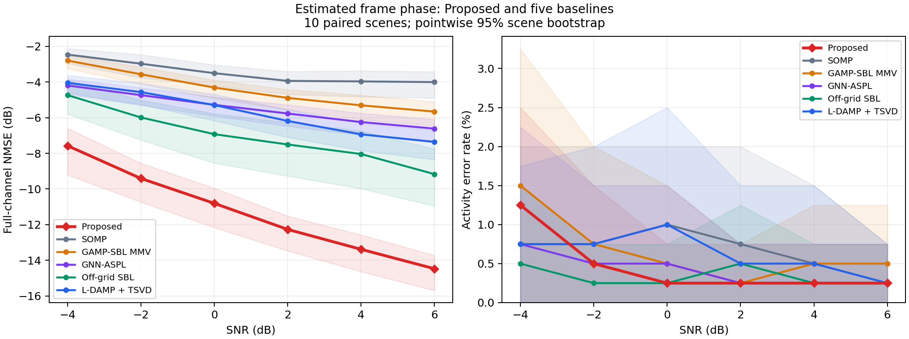

# 未知跨帧相位：Proposed 与五个 baseline

主要评价完整信道 NMSE 和 AER。Proposed 先从原始导频与观测估计跨帧相位，再运行三网络与消息传递。

## Material Passport

- Type: Experiment Result; mode: run
- Status: VERIFIED saved outputs, paired inputs, phase parity, metrics and one full-pipeline rerun
- Scope: 10 physical scenes × 6 SNRs; 60 new Proposed outputs and 300 bound baseline outputs
- Provenance: PLAN.json, ROWS.json, COMPARISON_ROWS.json, PHASE_PARITY.json, OUTPUT_AUDIT.json

40 个候选用户、16 帧、4×4 UPA、连续 off-grid 信道。每档 SNR 的同一批十个场景共有 49 个活跃、351 个非活跃用户实例。
六种方法使用同一批观测、原始导频、公开噪声方差和活动先验；Proposed 对每个条件重新估计相位，60 组相位及有效算子均与五基线评测逐项精确一致。
原一阶／二阶 score 和活动分类器、0.2 新值权重、600 轮上限及 0.5 活动概率阈值在本轮冻结。原始训练数据与本面板的种子分离依据沿用已绑定的 SEED_AUDIT.json。
本轮没有在该面板训练网络、标定阈值或选择相位参数。五基线使用其已保存输出，校验输入和输出哈希后合并。

## 完整信道 NMSE / dB

按全部场景的误差能量之和除以真信道能量之和计算，包含非活跃用户误差，输出不按活动判决置零。

| SNR / dB | Proposed | SOMP | GAMP-SBL MMV | GNN-ASPL | Off-grid SBL | L-DAMP + TSVD |
|---:|---:|---:|---:|---:|---:|---:|
| -4 | -7.573 | -2.462 | -2.798 | -4.195 | -4.736 | -4.048 |
| -2 | -9.408 | -2.974 | -3.567 | -4.737 | -5.987 | -4.568 |
| 0 | -10.806 | -3.506 | -4.312 | -5.280 | -6.927 | -5.294 |
| 2 | -12.267 | -3.937 | -4.891 | -5.767 | -7.505 | -6.185 |
| 4 | -13.383 | -3.967 | -5.309 | -6.245 | -8.039 | -6.934 |
| 6 | -14.471 | -4.006 | -5.661 | -6.614 | -9.166 | -7.360 |

## 活动错误率 AER / %

漏检与虚警之和除以全部候选用户数；漏检、虚警及逐场景原始量均保留。

| SNR / dB | Proposed | SOMP | GAMP-SBL MMV | GNN-ASPL | Off-grid SBL | L-DAMP + TSVD |
|---:|---:|---:|---:|---:|---:|---:|
| -4 | 1.250 | 0.750 | 1.500 | 0.750 | 0.500 | 0.750 |
| -2 | 0.500 | 0.750 | 0.750 | 0.500 | 0.250 | 0.750 |
| 0 | 0.250 | 1.000 | 0.500 | 0.500 | 0.250 | 1.000 |
| 2 | 0.250 | 0.750 | 0.250 | 0.250 | 0.500 | 0.500 |
| 4 | 0.250 | 0.500 | 0.500 | 0.250 | 0.250 | 0.500 |
| 6 | 0.250 | 0.250 | 0.500 | 0.250 | 0.250 | 0.250 |

## 与 baseline 的同场景比较

| SNR / dB | 最低 NMSE 的 baseline | Proposed − baseline / dB | Proposed 漏检 / 虚警 |
|---:|---|---:|---:|
| -4 | Off-grid SBL | -2.837 | 5 / 0 |
| -2 | Off-grid SBL | -3.421 | 2 / 0 |
| 0 | Off-grid SBL | -3.879 | 1 / 0 |
| 2 | Off-grid SBL | -4.762 | 1 / 0 |
| 4 | Off-grid SBL | -5.344 | 1 / 0 |
| 6 | Off-grid SBL | -5.305 | 1 / 0 |

负差值表示 Proposed 的 NMSE 更低。活动错误率每 0.25 个百分点对应一个用户判决错误。
置信区间以物理场景为单位进行 5000 次重采样，为逐点区间；十个场景及单组训练权重提供有限规模证据。
若某档 AER 的全部观测均为零，场景重采样区间也会为零；这描述本批样本，不能解释为总体错误概率为零。

## 核验与耗时

- 60 个 Proposed 输出重新核验 NMSE 误差能量、活动概率阈值、漏检及虚警，一致。
- 公开输入仅有 observation、pilot、noise_variance、activity_prior；真值在推断完成后用于评分。
- 原始输入与固定源码、配置和权重身份核验通过；与五基线对应的相位和测量算子逐项一致。
- scene000/snr+00 的完整新入口复跑逐项精确一致：True；直接调用原条件 Proposed 的输出逐项精确一致：True。活动判决一致，共享输入未被修改。
- 接口、输入隔离、数学前向／梯度和阶段组合测试通过。相关浮点警告保存在各条件的 warnings.json。

| 阶段 | 每条件平均耗时 / s |
|---|---:|
| 相位估计 | 6.3317 |
| 条件 Proposed | 13.7479 |
| 总计 | 20.0797 |

Proposed 停止原因：{"CONVERGED": 60}；平均迭代 95.90 轮。
相位前端为单线程 CPU，Proposed 网络使用记录的设备。计时包含完整相位阶段，不含模型加载与数据生成。
相位优化记录及估计参数作为辅助诊断保留在原始输出中。

## 统计解释核查（11/11）

| 项目 | 本轮处理 |
|---|---|
| Simpson 悖论 | 按 SNR 分层报告 |
| 生态谬误 | 场景级区间仅解释场景总体，用户误差另计 |
| Berkson 选择偏差 | 生成分布条件于至少一名活跃用户 |
| 碰撞变量偏差 | 全部计划场景参与汇总 |
| 基率忽略 | 同时保留活跃／非活跃人数及漏检／虚警 |
| 均值回归 | 比较使用相同输入，不从不同历史面板推断改进 |
| 幸存者偏差 | 失败保留；完整性检查通过后才报告完成 |
| 多重寻找效应 | 六档 SNR 完整展示，区间逐点、未校正 |
| 分析路径选择 | 配置冻结后运行，无评测集调参 |
| 相关与因果 | 结论限定于记录的模拟条件 |
| 反向因果 | 模拟生成与推断方向固定 |

方法与来源：[Proposed 未知相位说明](../../../docs/PROPOSED_UNKNOWN_PHASE.md)、[术语依据](../../../docs/TERMINOLOGY.md)。
