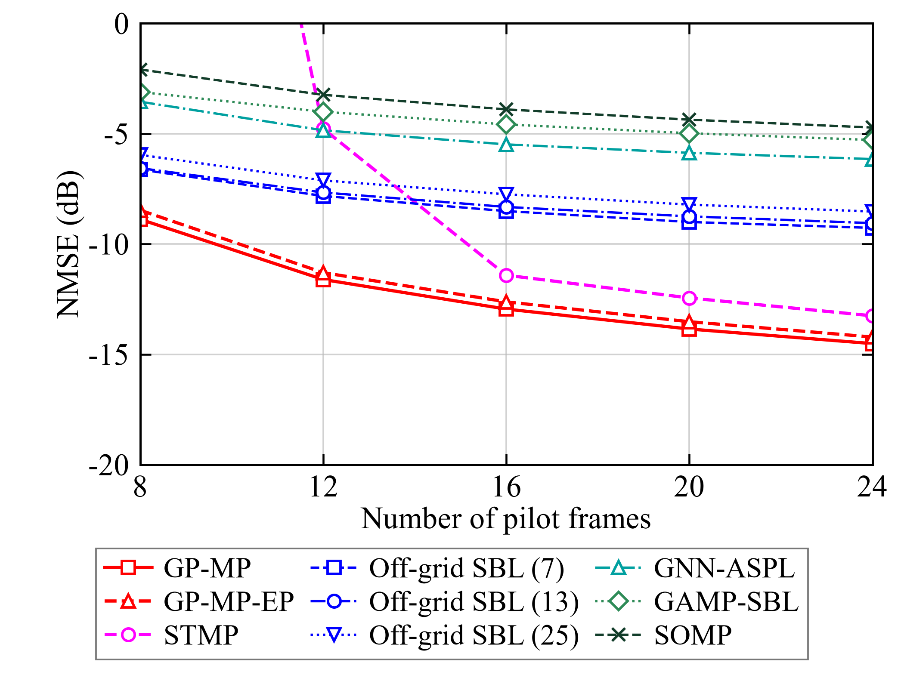

# 最新导频 NMSE 图（2026-11-09）



导频帧数为 8、12、16、20、24，每点 500 个配对场景，共九条曲线、22,500 份结果（包含验证复用）。GP-MP 和 GP-MP-EP 使用白噪声训练模型；8 帧阻尼 0.3，其余 0.4。仅报告能量汇总 NMSE。原始逐场景预测保留本地。

采用作者确认的三列图例格式，字体、画布和坐标轴沿用用户数实验图。纵轴固定 −20 至 0 dB，STMP 的 8 帧点超出显示范围；其完整数值保留在 SUMMARY.json，没有删除样本。

此目录为最新独立实验图，尚未替换论文中的历史图与文字。旧结果保留供追溯。COMPLETION.json 是本地完整核验收据，其中逐场景证据未随本次小型图表更新上传。

复现绘图（仓库根目录，PowerShell）：

```powershell
$env:PYTHONPATH = "$PWD/src"
python result/pilot_frames/latest_20261109/render.py
```

只读取已验证的 SUMMARY.json，不运行实验或加载模型权重。
