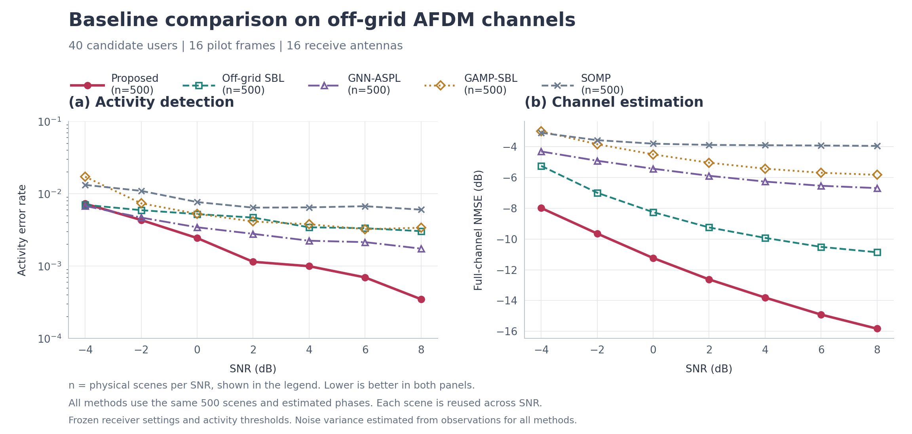

# 五方法 500 场景最终比较

2026-10-18 按用户要求，将原 600 场景计划调整为前 500 个完整物理场景。500 × 7 SNR × 5 方法 = 17500 次推断全部完成并核验；全部计算进程已停止。未按性能筛选场景。

## 实验条件与结果

40 候选用户、16 导频帧、16 接收天线，原 PartialDFTPilot，连续离网格信道；五方法共享同一场景、观测与估计相位，均采用观测驱动噪声估计。原三网络、条件推断、权重与活动门限保持。SNR 为实现的完整无噪接收功率与热噪声方差之比。同一物理场景与标准噪声在各 SNR 重用。

独立 Bernoulli(0.1) 活动生成后拒绝全空场景的协议保持不变；条件化后单用户活动边际约 0.10150，并非严格 0.1。没有删除弱用户或不利场景。

AER = (漏检 + 虚警) / (500 × 40)，图中使用概率值和对数纵轴。完整信道 NMSE = 10log10(总误差能量 / 总真值能量)，包括非活跃用户的估计误差。CSV 中 aer_percent 仍为百分数，绘图时除以 100。

| SNR/dB | Proposed AER | 漏检/虚警 | Proposed NMSE/dB | 最低 baseline AER | 最佳 baseline NMSE/dB |
|---:|---:|---:|---:|---:|---:|
| -4 | 7.300e-03 | 145/1 | -7.983 | 6.800e-03 (gnn) | -5.243 (offgrid_sbl) |
| -2 | 4.350e-03 | 87/0 | -9.641 | 4.700e-03 (gnn) | -6.990 (offgrid_sbl) |
| 0 | 2.450e-03 | 48/1 | -11.233 | 3.450e-03 (gnn) | -8.252 (offgrid_sbl) |
| 2 | 1.150e-03 | 20/3 | -12.623 | 2.800e-03 (gnn) | -9.244 (offgrid_sbl) |
| 4 | 1.000e-03 | 16/4 | -13.803 | 2.250e-03 (gnn) | -9.925 (offgrid_sbl) |
| 6 | 7.000e-04 | 10/4 | -14.910 | 2.150e-03 (gnn) | -10.509 (offgrid_sbl) |
| 8 | 3.500e-04 | 7/0 | -15.825 | 1.750e-03 (gnn) | -10.860 (offgrid_sbl) |

Proposed 在全部七档 SNR 的完整信道 NMSE 最低，较最优 baseline 改善约 2.65～4.97 dB；AER 在 −2～8 dB 最低。在 −4 dB，Proposed AER 为 0.00730，略高于 GNN-ASPL 的 0.00680 和 Off-grid SBL 的 0.00705。以上为本批点估计比较，不等同于全部差异已通过显著性检验。高 SNR 错误数较少，曲线斜率不应过度解释；未人工平滑。

## 相位与噪声前端验收

相位仍为原两轮完整搜索，优化固定几何计算、导数和批量相关计算。30 场景、240 条件的五组相位数组逐元素完全相同，保持已验证精度，不宣称绝对精度提升。8 个不同场景、交替执行并清除几何缓存的独立计时：平均 6.035 s → 4.309 s，减少 28.6%。计时与等价证据分别见 ../phase_optimization_20261017/ISOLATED_TIMING.json、PHASE_EQUIVALENCE_CHECK.json。此前局部搜索方案未通过验收，历史结果完整保留。

Proposed 观测驱动空间协方差 MDL 噪声估计在 20 场景、160 条件中没有改变活动判决；逐 SNR 汇总 NMSE 最大恶化 0.0623 dB，小于预设 0.15 dB 容差，最坏单条件恶化约 0.1676 dB。按用户规则选择估计噪声。证据见 ../phase_optimization_20261017/NOISE_DECISION.json 和 noise_fresh/SUMMARY.json。历史文件中的 mainline_promoted=false 是采用前快照，实际采用见 PUBLIC_INTEGRATION.json。该估计依赖空间低秩信号加白噪声假设，不声称一般无偏。

## 核验与保留

- VERIFICATION.json：17500 次指标、逐用户误差与活动判决核验；scene000、scene200 的 70 份完整原生输出独立重评分。
- RECORD_AUDIT.json：3500 个公共输入重建与身份核对，17500 份原生记录核对；确认共享相位和估噪信息边界，接收机未使用真值评分信息。
- 所有结果原先均在内存中对完整原生输出评分；磁盘只在上述两场景保留完整输出，其余保存标量、向量、逐用户误差和完整数组哈希，不声称全部完整矩阵均可从磁盘重评分。
- 原始记录保留在 ../baseline_comparison_600_20261017/scenes/scene000 至 scene499，未复制或改写。原600计划冻结文件保留，修订范围见本目录 PLAN.json 和原目录 SCOPE_REVISION_500.json。
- 停止轮询期间 producer 已开始 scene500 的准备，但该场景没有任何已完成算法指标；全部残留保留，不计入用户指定的前500场景。
- NumPy 运行警告和算法停止原因保留，见 RECORD_AUDIT.json；不能将完成推断等同于每次均满足收敛判据。并行运行时间不是独立算法延迟基准。
- STATISTICS.csv 包含 10000 次按物理场景重采样的描述性逐点区间，不是同时置信保证，也未针对用户查看阶段结果后改变样本规模作序贯推断校正。

## 复现报告

在项目根目录运行 `.venv/bin/python results/baseline_comparison_500_20261018/report.py`，随后运行同目录 `record_audit.py`。前者校验原冻结源和权重，并调用独立对数轴绘图器。绘图器位于 experiments/comparison_log_aer_20261018/render.py。最终 PNG/PDF/SVG 图例均 n=500，已人工查看布局和对数刻度。
